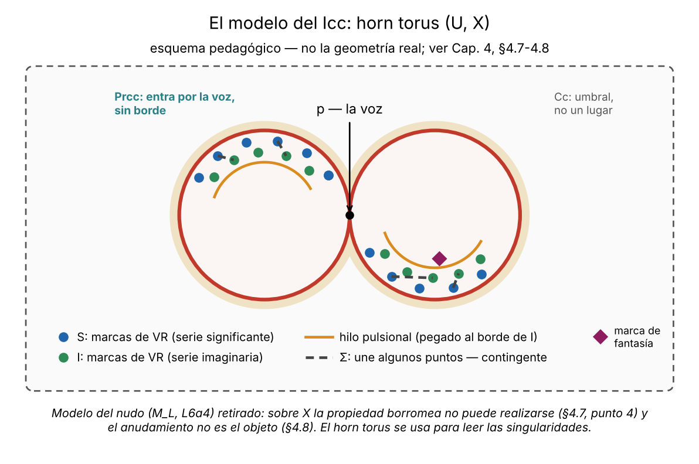
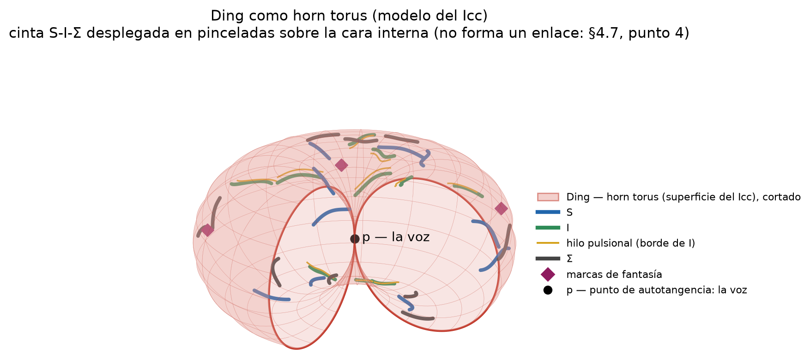
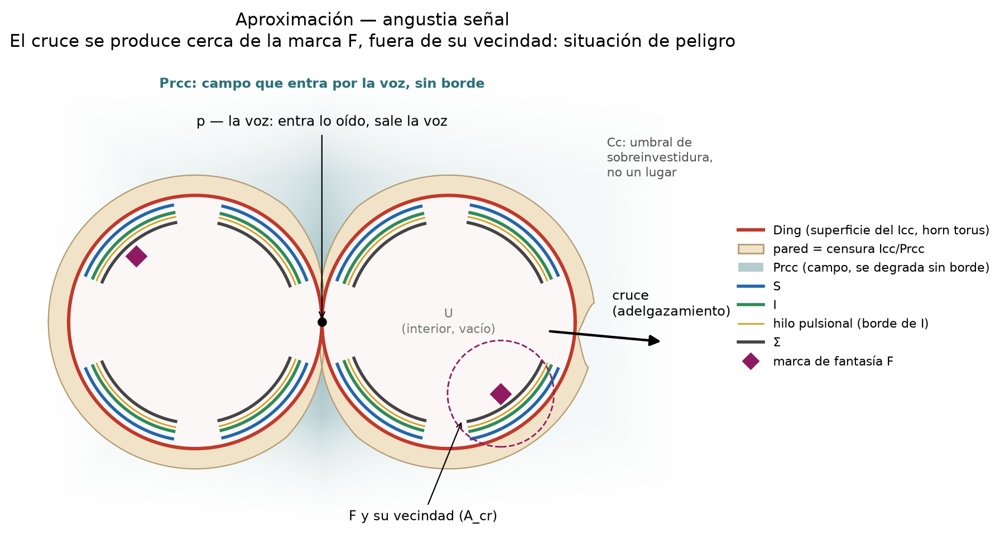
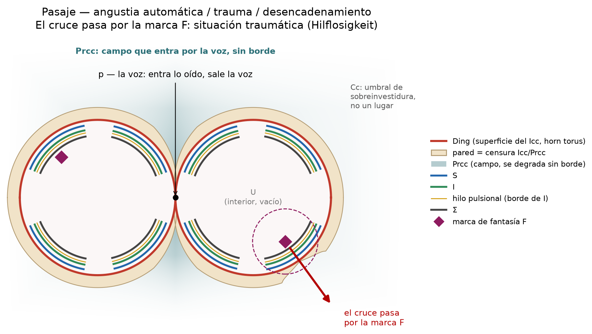
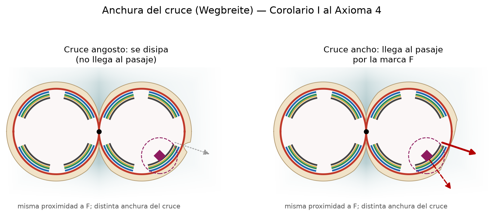
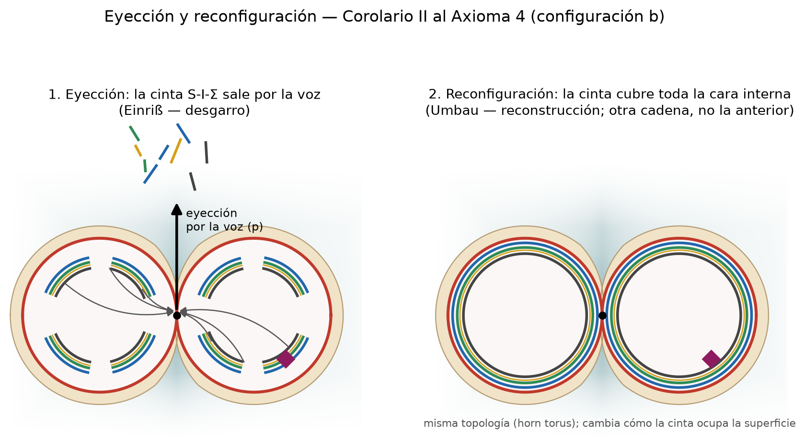

# El modelo del horn torus del Icc

Descripción pública del modelo que implementa la app. Sigue la disciplina del trabajo del que proviene: cada afirmación se marca según su estatuto.

- **CITA** — verificada contra el texto original, con ubicación.
- **LECTURA** — resonancia razonable, todavía sin confirmar como equivalencia.
- **AXIOMA** — construcción propia del modelo, sin anclaje textual.

La geometría es exacta; su lectura psicoanalítica es, salvo indicación, **AXIOMA**. Nada de lo que muestra la app es un diagnóstico.

Este documento sigue la tesis en su versión **V52** (15 de octubre de 2026), con las decisiones del autor posteriores a esa versión señaladas como tales. Las referencias de versión dentro de la app (V47, V49) se actualizan aparte.

## 1. El modelo: el horn torus del Icc

El modelo es el par **(U, X)**: el horn torus X con su interior U. Es lo que dibuja la app.

- **S e I** son **marcas de representaciones (VR) sobre la cara interna** del horn torus, ligadas a la pulsión: la serie significante y la serie imaginaria, inscriptas una por una sobre la superficie.
- **Σ** une **algunos** de esos puntos, y es **contingente**: que una VR se active y encadene a otras no está garantizado.

Decisión del autor, posterior a la V52 — **AXIOMA**: el modelo del nudo (el complemento de un nudo borromeo estándar, L6a4, M_L = S³∖N(L)) **ya no se usa**. La propiedad borromea no se aplica sobre el horn torus —tres curvas cerradas disjuntas sobre X solo pueden ser círculos coaxiales, que no están enlazados (§4.7, punto 4)—, y la tesis, desde la V50 (§4.8), argumenta que preguntar si S, I y Σ forman un borromeo es un error de categoría. La identificación L = S ∪ I ∪ Σ quedó retirada. La app nunca calculó nada de ese modelo.

Queda a definir qué estatuto tienen, sin M_L, el invariante de Milnor, la forma cuspidal y el objeto a como el punto −i, que en la V52 se formalizaban allí.

### Configuraciones (Axioma 2, rearticulado en V47) — AXIOMA

En la V52, la distinción entre dos configuraciones de origen se define por la relación entre los **soportes** de las dos series (las zonas de la superficie donde se inscriben S e I) y por el estatuto modal de Σ. Con la decisión del autor posterior a la V52 —Σ siempre contingente— la distinción queda así:

- **(a)** hay **correspondencia de origen** entre la serie significante (S) y la imaginaria (I): en la V52, los soportes se superponen y su unión es conexa. Se asocia a la neurosis.
- **(b)** la correspondencia de origen **falta**: en la V52, los soportes son disjuntos y entre ellos media un trecho de superficie. Se asocia al Border (psicosis no desencadenada).
- En ambas, Σ es **contingente**: une algunos puntos y puede o no suplir la correspondencia que falta en (b). Ya no se lo describe como «exigido» en (b), como hacía la V52.
- Sobre (b), según lo indicado por el autor — **AXIOMA**: es el caso de la psicosis no desencadenada. Se lo entendió así: mientras Σ liga, aunque sea de manera contingente, el sujeto se sostiene; el Corolario II (ruptura) se abre solo cuando Σ deja de ligar y un cruce llega a una marca con anchura suficiente. Esta lectura quedó pendiente de confirmación por el autor.
- Sobre (a), confirmado por el autor — **AXIOMA**: con correspondencia de origen, la ruptura del Corolario II **no se abre**. Un pasaje por una marca puede ser traumático (Axioma 4), pero no dispersa ni eyecta la cinta. El Corolario II queda condicional a (b), como en la V52.

Pendiente de definir: si el criterio geométrico de la V52 (superposición o trecho entre soportes) sigue siendo lo que expresa la presencia o ausencia de correspondencia de origen, y qué consecuencia tiene eso para el Corolario II, que la V52 deja condicional a (b).

Que la suplencia de (b) resuene con el sinthome es **LECTURA**, no identidad; el sinthome sigue sin definirse, y el autor lo toma como **contingente** (AXIOMA), lo que queda en tensión con el §4.8 de la tesis (V50), que lo describe como la modalidad exigida de Σ. En la app, el botón «Config Axioma 2» alterna (a) y (b) y separa o junta visualmente las bandas.

## 2. La superficie

El horn torus es el toro de revolución con R = r: el círculo interno colapsa a un punto **p** (el punto de autotangencia). Topológicamente es una esfera con dos puntos identificados. **No es una variedad**; su característica de Euler es χ = 1 y el género no está definido. Divide el espacio en dos regiones (dualidad de Alexander): el interior, un toro sólido abierto, y el exterior.

- **Toda la superficie es el Icc** — AXIOMA.
- **La pared es la censura Icc/Prcc**: un límite nítido, con adelgazamientos variables que son vías de salida (palabra deformada, Agieren, sublimación) — AXIOMA.
- **S, I y Σ** desplegados sobre la cara interna (la app los dibuja como cintas); el hilo pulsional (Trieb, Drang constante) corre pegado al borde de I, la imagen del cuerpo — AXIOMA.

## 3. La voz y el Prcc

**p es el único orificio fijo, de doble sentido: por él entra lo oído y sale la voz.**

- CITA — Lacan, *Seminario XI*, clase del 20 de mayo de 1964: las orejas son el único orificio del campo del inconsciente que no puede cerrarse; en la discusión de esa clase, Lacan nombra, de modo tentativo, la «pulsión invocante».
- CITA — Freud, *Das Ich und das Es* (1923), GW XIII, cap. II: los restos de palabra provienen esencialmente de percepciones acústicas, lo que da al sistema Prcc un origen sensorial particular; la palabra es el resto mnémico de la palabra oída.
- CITA — ibíd., cap. V: el superyó no puede desmentir su procedencia de lo oído, pero la energía de investidura de sus contenidos viene del ello, no de la percepción auditiva.

**El Prcc no es un espesor de la pared: es el campo de representaciones-palabra que entra por p**, concentrado en el embudo que el exterior del horn torus forma a lo largo del eje y comunicado con toda la superficie, **sin un borde donde termine** — AXIOMA.

**La Cc no es un lugar, sino un umbral** de sobreinvestidura dentro de ese campo:

- CITA — Freud, *Das Unbewusste* (1915), GW X, sección VI: la diferencia más significativa no hay que buscarla entre consciente y preconsciente, sino entre preconsciente e inconsciente; los retoños del Icc crecen en el Prcc hasta cierta intensidad de investidura y, al sobrepasarla, se topan con una segunda censura entre Prcc y Cc; el hacerse consciente es probablemente una sobreinvestidura.

La asimetría —límite nítido entre Icc y Prcc, paso sin borde entre Prcc y Cc— tiene apoyo textual; su forma geométrica (embudo, campo sin borde) es AXIOMA. En la app, el campo se dibuja como una nube de puntos fuera del volumen, más densa cerca de p.

## 4. Marcas de fantasía y angustia

La fantasía (concepto freudiano) son **marcas Icc de trauma** sobre la cara interna, distintas entre sí y de contenido desconocido: se ven sus efectos, no lo que son. La app admite una o varias — AXIOMA.

La angustia surge por **proximidad** a una marca, en dos regímenes:

| | |
|---|---|
|  |  |
| **Aproximación:** un cruce se produce cerca de la marca, fuera de su vecindad — situación de peligro, angustia señal. | **Pasaje:** el cruce pasa por la marca — situación traumática (desvalimiento). |

- CITA — Freud, *Hemmung, Symptom und Angst* (1926), GW XIV, p. 199: la situación traumática es de desvalimiento (Hilflosigkeit); en la situación de peligro, que la anticipa, se da la señal de angustia.
- CITA — Lacan, *Seminario X*: la angustia es «lo que no engaña» (8 de mayo de 1963) y «no es sin objeto» (29 de mayo de 1963).
- LECTURA — que el pasaje produzca angustia automática porque la marca está «no ligada» (Freud, *Jenseits des Lustprinzips*) equivale «no simbolizado» a «no ligado»; Freud habla de ligadura, no de simbolización.

En la app, A(u, v) mide la proximidad (distancia periódica) a la marca más cercana; la vecindad crítica es la unión de discos de radio A_cr = π/4 alrededor de las marcas, y el resumen informa el porcentaje de **área**.

## 5. Anchura del cruce (Wegbreite)

A igual proximidad, un cruce angosto se disipa y uno de anchura suficiente llega al pasaje.

- CITA — Freud, *Entwurf einer Psychologie* (1895): la anchura de vía (Wegbreite) es un factor distinto de la cantidad y de la resistencia.
- AXIOMA — su traslado al ancho del adelgazamiento de la pared. En la app es el parámetro δ; el techo es π/6.

## 6. Ruptura del modelo

Con IGS ≥ 3× el corte T=60 de la población y anchura suficiente, la cinta sale eyectada por la voz y luego se reconfigura cubriendo la cara interna. La topología no cambia; cambia cómo la cinta ocupa la superficie.

- CITA — Freud, «Neurose und Psychose» y «Der Realitätsverlust bei Neurose und Psychose» (1924): desgarro (Einriß) de la relación del yo con la realidad y fase de reconstrucción (Umbau).
- AXIOMA — su identificación con la eyección por la voz y la reconfiguración de la cinta.

**Esta secuencia no infiere estructura clínica.** Un Psicoticismo alto no es forclusión, y un IGS extremo no es un diagnóstico.

**Diferencia entre la tesis y la app.** En la tesis (V52, y confirmado por el autor), este mecanismo —el Corolario II (Umbau)— queda **condicional a la configuración (b)**: en (a) la reactivación no dispersa ni eyecta. La app **todavía no implementa esa condición**: la secuencia de ruptura depende de IGS y de δ, no de (a) o (b); la configuración solo cambia la disposición visual de las bandas.

## 7. Pregunta abierta: Σ como pantalla

No está decidido si Σ opera como **pantalla** que aleja los cruces de las marcas o si opera sin incidir en dónde se producen los cruces. La app lo hace conmutable («Σ como pantalla») y compara el área de la zona de angustia en los dos regímenes.

Nota de versión: la tesis (V52, §6.4) todavía formula la segunda opción como «anudando a S e I en M_L». Esa formulación quedó en tensión con el §4.8 (V50) y con el abandono de M_L, que retiran el anudamiento como estructura de enlace; la pregunta sigue abierta, pero su segunda rama debe releerse como «Σ sin incidir en la ubicación de los cruces», y su reformulación en la tesis está pendiente.

## 8. SCL-90-R

- Baremos de Casullo – Pérez (UBA): adultos y adolescentes, por sexo. T < 60 normal; T ≥ 60 sintomático; T ≥ 63 en riesgo.
- Carga por puntajes directos (con validación de consistencia) o por puntajes T (convertidos a PD con el baremo; fuera de la tabla, extrapolación marcada).
- **Todas las asignaciones entre escalas y geometría son AXIOMA** (por ejemplo, S ← Ansiedad y Obsesión; I ← Somatización y Sensibilidad Interpersonal; Σ ← Psicoticismo y Hostilidad). No son resultados validados; el instrumento que las fundaría requiere definiciones operacionales, validez convergente y discriminante, y una función de mapeo no circular.

## Pendiente de verificación

- Paginación exacta de las citas de GW XIII (caps. II y V) y GW X (secc. VI), y cotejo con Amorrortu.
- Cotejo del *Seminario XI* con la edición Paidós.
- Que la app condicione la secuencia de ruptura (Corolario II) a la configuración (b), como pide la tesis V52, o que se decida mantenerla independiente y se declare.
- Reformulación, en la tesis, de la pregunta «Σ como pantalla o mero anudamiento» (§6.4) a la luz del §4.8.
- Revisión, por un topólogo, de dos cálculos propios: que el exterior del horn torus es simplemente conexo, y que tres curvas disjuntas sobre él no pueden formar un nudo borromeo.
